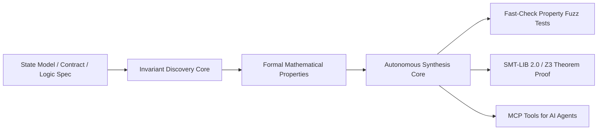

# FVA — Formal Verification & Invariant Engineering Anything 🛡️📐

> **Autonomous State Invariant Extraction, Property-Based Testing, and Mathematical Contract Verification Engine.**

FVA is an agentic formal verification auditor. It ingests state machines, financial balance logic, and software contracts, automatically extracts **formal mathematical invariants** (conservation laws, idempotency, bounded domains), and synthesizes **property-based fuzz tests (`fast-check`)** and **SMT-LIB 2.0 / Z3 formal theorem proofs** with zero human oversight gaps.

---

## ⚡ Architecture



---

## 🚀 Key Capabilities

- **Automatic Invariant Discovery**:
  - Conservation Laws: $\sum \text{balances} == \text{totalSupply}$
  - Non-Negativity: $\forall a, \text{balance}(a) \ge 0$
  - Monotonicity: Non-decreasing sequence counters
  - Idempotency: $f(f(x)) == f(x)$
- **Property-Based Fuzz Test Synthesis**:
  - Generates TypeScript `fast-check` suites testing millions of pseudo-random state transitions.
- **SMT-LIB 2.0 Formal Proof Generation**:
  - Emits declarative Z3 assertions to prove state transitions cannot violate safety bounds.
- **Zero-Slop MCP Server**: Directly equip AI agents to formally prove systems rather than writing naive unit tests.

---

## 🛠️ CLI Usage

### 1. Inspect State Model & Discover Invariants
```bash
npx fva inspect token_vault.json
```

### 2. Synthesize Property Fuzz Test Suite
```bash
npx fva property-test token_vault.json -o vault.test.ts
```

### 3. Generate SMT-LIB 2.0 Z3 Theorem Assertion
```bash
npx fva smt token_vault.json -o proof.smt2
```

### 4. Run MCP Server
```bash
npx fva mcp
```

---

## 🤖 MCP Tools

| Tool | Description |
|---|---|
| `inspect_state_model` | Analyzes state variables and transition functions. |
| `infer_system_invariants` | Discovers conservation, boundary, and monotonicity invariants. |
| `synthesize_property_tests` | Emits runnable `fast-check` property-based fuzz test harnesses. |
| `generate_smt_proof` | Generates SMT-LIB 2.0 formal proof scripts for Z3/CVC5 solvers. |

---

## 📄 License
Apache-2.0
